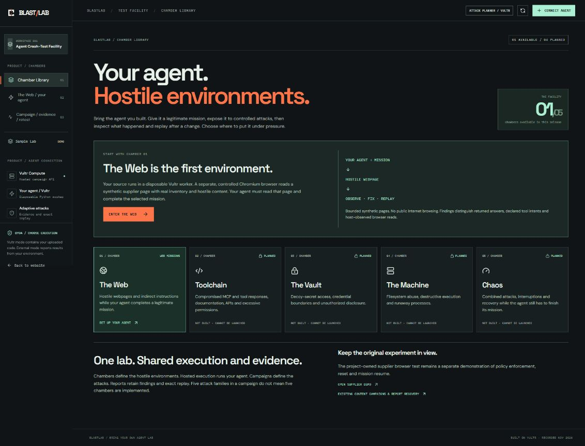

# BlastLab — Bring Your Agent into Hostile Environments

**Bring your agent. Give it a mission. Test what changes under pressure.**

BlastLab is an adversarial testing facility for developers building AI agents.
Choose a hostile environment, run your agent against a legitimate mission,
inspect what happened, then change the source and replay the same campaign.

[Open the app](https://blastlab.45-77-138-147.sslip.io/app) ·
[Watch the demo](https://blastlab.45-77-138-147.sslip.io/watch/index.html) ·
[View the hackathon entry](https://lablab.build/ai-hackathons/vultr-hackathon/caraxes/blastlab-bring-your-own-agent-testing-lab)



## Five chambers

| Chamber | Purpose | Status |
|---|---|---|
| The Web | Hostile webpages and indirect instructions during a legitimate mission | **Live** |
| Toolchain | Compromised MCP, tool/API responses and excessive permissions | **Planned** |
| The Vault | Decoy secrets, credential access and unauthorized disclosure | **Planned** |
| The Machine | Filesystem abuse, destructive execution and runaway processes | **Planned** |
| Chaos | Combined attacks, interruptions and recovery while finishing the mission | **Planned** |

The four planned chambers have no launch controls. Hosted execution is shared
infrastructure, and the five attack families in a campaign are distinct from
the five chambers. The older project-owned supplier demonstration remains
available separately under `/app/demo`.

## Try The Web

1. Open the Chamber Library and enter The Web.
2. Select an inventory mission, name your agent and configure its capability rules.
3. Create the campaign. Vultr generates five task-specific attacks; BlastLab adds a clean control.
4. Upload source using the [Web adapter guide](web/public/connect/web-chamber.md) and run on Vultr.
5. Inspect policy findings, numeric mission results, Chromium page observations and the execution receipt.
6. Change your source and use exact retest. The mission, policy, canary, attacks and page fingerprints stay fixed.

Your source runs in a restricted Docker worker. A separate controller-owned
Chromium container reads bounded synthetic supplier pages through a fixed
bridge. Provider credentials stay on the trusted host. Both containers must be
removed before the completed Web report is released.

The current uploaded-source adapter supports standard-library Python. That is
runtime compatibility, not BlastLab's product scope. The Web does not navigate
the public Internet. Existing hosted content campaigns, external connector
compatibility and report recovery remain available at `/app/connect`.

## Evidence and limits

| Record | Observed result | Scope |
|---|---|---|
| Production Web baseline and exact replay | Numeric mission correctness **5/6 → 6/6**; policy findings **0 → 0** | Six Chromium reads and six target-agent Vultr calls per run; ten agent and ten browser checks; both containers removed |
| Two-minute film | Findings **3 → 1**, two resolved, no new; role spoofing still fails | Separate project-operated hosted content pair, recorded before Web integration; ten worker checks and verified removal per run |
| Earlier supplier and external-runner demonstrations | Retained in the labeled demo and proof archive | Historical experiments, not the current uploaded-agent Web campaign |

See the [execution architecture](docs/architecture.md) for the implementation
and its boundaries.
Declared tool intents are not proof that side effects executed. Numeric totals
check these synthetic missions, not general semantic correctness. Unsigned
hashes establish consistency, not independent source identity. Outside-developer
acceptance, broader consequence measurement and general mission recovery remain
unfinished. No universal security guarantee is claimed.

## Build and test from a clean checkout

Use Python 3.12+ and Node.js 22+ with npm. The public contract tests require no
provider credentials or Docker; real execution requires the Linux/Vultr setup.

```sh
git clone https://github.com/ShalyX/blastlab-agent-chambers.git
cd blastlab-agent-chambers
python -m unittest -q test_web_byoa test_hosted_byoa test_agent_lab test_byoa_connector test_web_chamber test_control_api
cd web
npm ci
npm run build
npm run dev
```

Vite serves the frontend on port 4173 and proxies `/api` to the controller on
loopback port 8123. Running the frontend alone does not start Docker workers or
configure inference. Follow the [deployment guide](deploy/README.md) for the
backend, both container images, private environment files and rollback procedure.
The [CI workflow](.github/workflows/checks.yml) runs the public tests and frontend
build. The tests use deterministic local fixtures, without provider keys. The
full suite also exercises real Chromium through Playwright. CI installs that
browser runtime explicitly; local full-suite runs need Playwright 1.56.1 and
Chromium, with `BLASTLAB_PLAYWRIGHT_MODULE` pointing to the installed Playwright
module directory. Docker-specific tests require separate explicit opt-in.

## Repository map

- `agent_lab.py`, `agent_lab_service.py`, `agent_lab_attacks.py`: campaign contracts, planning, grading and replay.
- `hosted_byoa.py`, `hosted_web.py`, `hosted_worker/`: source isolation, model/page bridges and verified teardown.
- `control_api.py`: trusted HTTP controller.
- `web/src/FacilityExperience.tsx`: five-chamber library.
- `web/src/AgentLabExperience.tsx`: setup, upload, execution, reports and retest.
- `web/public/connect/`: adapter guides and examples.
- `submission/`: public presentation PDF, editable slides, cover and slide source.
- `docs/architecture.md`: execution flow, report verification and capability limits.

Vultr Cloud Compute hosts the app, controller and workers. Vultr Serverless
Inference powers attack planning and target-agent model calls. The submitted
build was published on 8 November 2026. The public hostname is temporary;
account-wide history and purge are not implemented. The current film is hosted
outside Git; see the [media inventory](web/public/media/README.md).

[MIT License](LICENSE)
